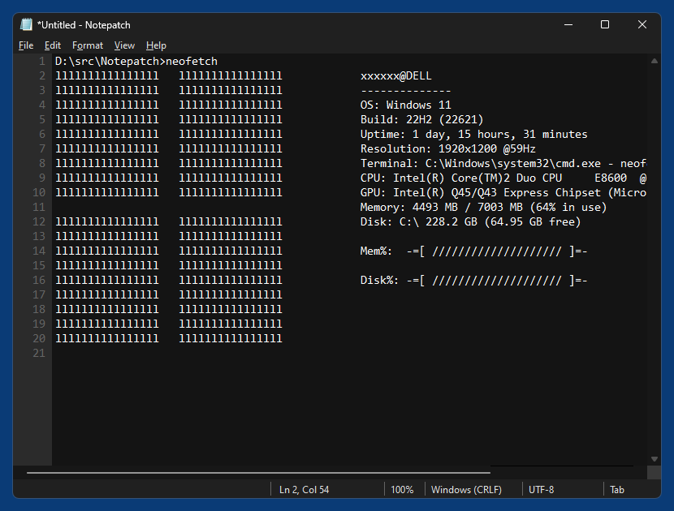

# Notepatch-CN（Notepatch 汉化增强版）

基于开源项目 [Notepatch](https://github.com/59de44955ebd/Notepatch) v0.3 修改的 Windows 记事本替代品，保留原生记事本的极简体验，完成了**全界面中文汉化**，并补齐/增强了原生记事本的快捷键。

## 功能特性

- 全中文界面：菜单、对话框、状态栏、提示信息全部汉化（EOL 与编码名称保留英文，与中文版 Windows 自带记事本显示习惯一致）
- 补齐原生记事本快捷键：
  - **缩放**：Ctrl + 滚轮 / Ctrl + "+" / Ctrl + "-" / Ctrl + 0 重置（10%–500% 限幅）
  - **横向滚动**：Shift + 滚轮 或 Ctrl + Shift + 滚轮
  - **F5** 插入时间日期、**Ctrl + A** 全选、**Esc** 退出全屏
- 原项目已有功能完整保留：行号、深色/浅色主题、窗口置顶、半透明、查找替换（支持 `^t` / `^n` 占位符）等
- 界面设置持久化：主题、半透明、窗口置顶、缩放比例、背景设置自动保存，下次启动自动恢复
- 自定义背景：「查看 → 背景」选择图片铺满编辑区（等比填充不变形）、不透明度 0–100% 实时调节、从背景提取窗口颜色

## 快捷键一览

| 类别 | 快捷键 |
| --- | --- |
| 缩放 | Ctrl+滚轮 / Ctrl+"+" / Ctrl+"-" / Ctrl+0 重置 |
| 横向滚动 | Shift+滚轮 或 Ctrl+Shift+滚轮 |
| 全屏 | F11 进入，Esc 或 F11 退出 |
| 编辑 | Ctrl+A 全选、F5 插入时间日期 |
| 查找 | Ctrl+F 查找、Ctrl+H 替换、Ctrl+G 转到行、F3 / Shift+F3 下一个/上一个 |
| 文件 | Ctrl+N 新建、Ctrl+O 打开、Ctrl+S 保存、Ctrl+Shift+S 另存为、Ctrl+Shift+N 新窗口、Ctrl+P 打印、Ctrl+W 关闭 |
| 视图 | Alt+N 行号、Alt+T 半透明、Alt+A 窗口置顶、Alt+D 深色主题、Alt+L 浅色主题 |

## 安装

下载 [Releases](../../releases) 页面的 `Notepatch-Setup-*.exe`，双击运行并按向导操作即可。安装程序会自动：复制程序到 `C:\Program Files\Notepatch`、写入注册表重定向、清理 Win11 的 UseFilter 过滤器，并在检测到商店版新记事本时询问是否卸载。卸载在「设置 → 应用」或开始菜单中进行。

通过注册表 Image File Execution Options 重定向替换系统记事本（不修改系统文件 notepad.exe，随时可逆）。自 1.0.6 起仅提供图形化安装程序，不再提供 bat 脚本安装包。

## 自行编译

- Visual Studio 2019（v142 工具集）+ Windows 10 SDK（10.0.19041.0）
- 打开 `Notepatch.sln`，选择 Release / x64 编译即可

## 更新日志

见 [CHANGELOG.md](CHANGELOG.md)。

## 致谢

原始项目：[59de44955ebd/Notepatch](https://github.com/59de44955ebd/Notepatch)，感谢原作者的出色工作。
